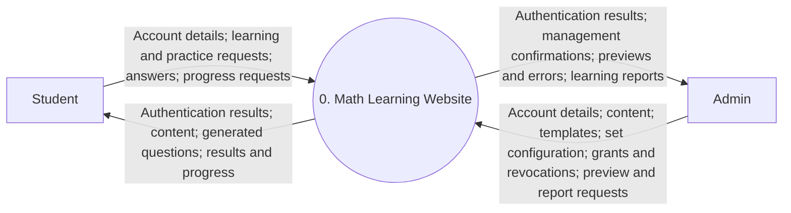
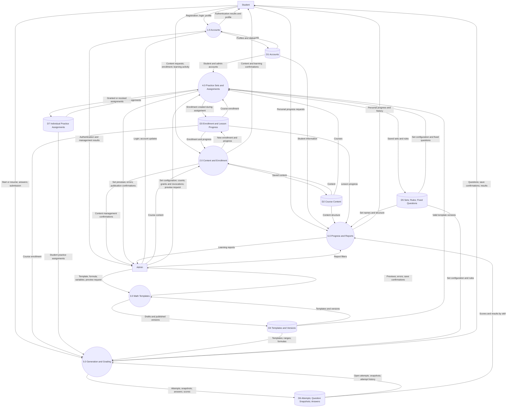
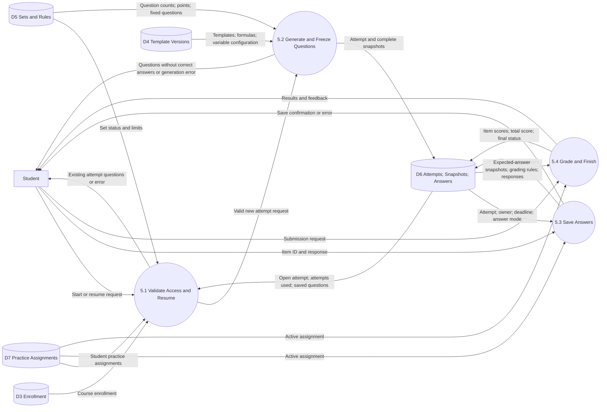
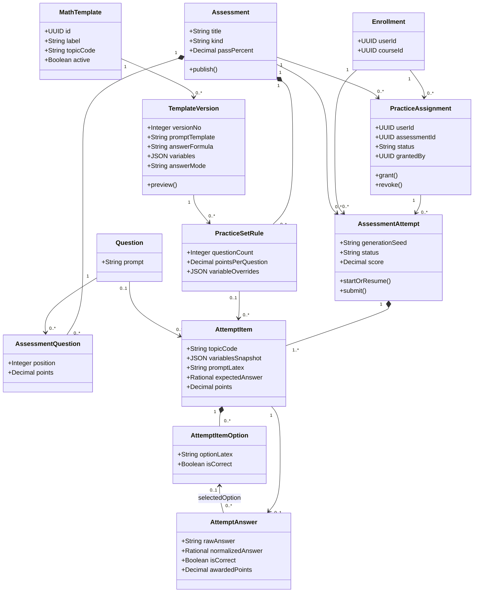
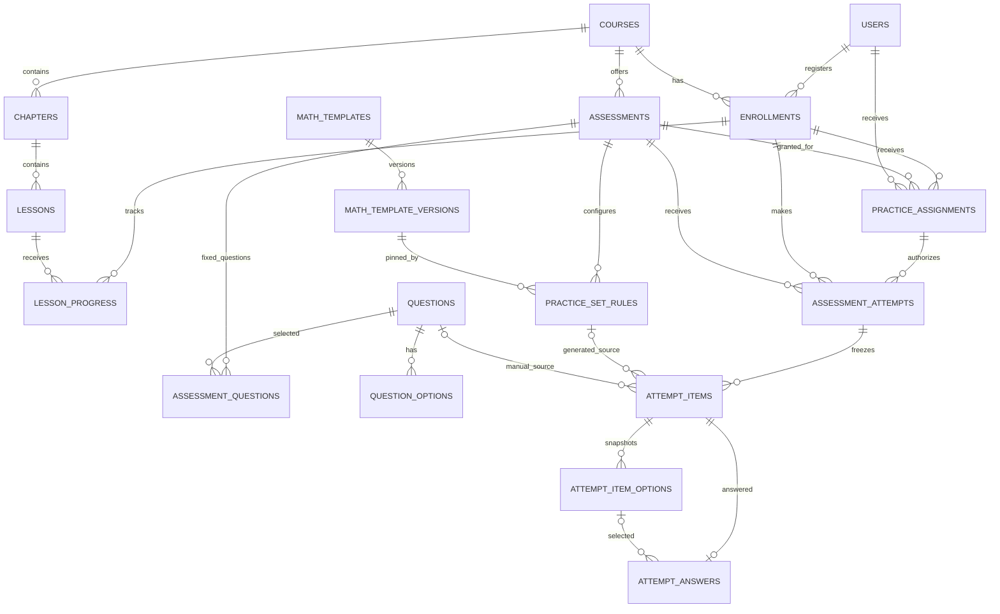

# Math Learning Website Design — Math Templates and Practice Sets

## 1. Requirements and core model

The first design had two roles, **student (USER)** and **administrator (ADMIN)**; the website now also has **TEACHER**, **SUPERVISOR** and **EDITOR** (section 10.1). Content is organized as subject → course → chapter → lesson, with practice activities and learning progress tracking. Staff create question templates using LaTeX, random variables, and answer formulas, then combine multiple templates into a practice set.

The two reference screenshots inform the form fields and syntax. Sections 1–9 are the original design; the website implements it (see `README.md`). Section 10 describes what was added afterwards.

**Example:** the **“LCM and Decimal Multiplication”** practice set has two configuration rows:

| Position | Math template | Version | Question count | Points per question |
|---|---|---|---:|---:|
| 1 | Least Common Multiple | v1 | 5 | 1 |
| 2 | Decimal Multiplication | v1 | 5 | 1 |
| **Total** | | | **10** | **10 points** |

By default, “select five questions” means **select a template and request five distinct generated questions**. Administrators may also select fixed questions from the question bank, stored in `assessment_questions`. A set may combine fixed and generated questions.

A template represents a family of questions. An LCM template with `{a}` and `{b}` can generate “LCM of 12 and 18” or “LCM of 8 and 20.” A practice set defines the structure, while an attempt contains **ten specific generated questions stored as immutable snapshots**.

## 2. Administrator features and interface

### 2.1. Math template management

The form includes the fields shown in the reference screenshots:

| Field | Meaning and rules |
|---|---|
| Label | Template name, such as Least Common Multiple |
| Topic | Skill code, such as `lcm` or `decimal_multiplication` |
| Place | One subject, course, chapter or lesson, picked from the content tree (section 10.2) |
| Template | Question text with LaTeX and `{placeholder}` tokens |
| Answer formula | Expression using the same variable names; required for graded questions |
| Answer mode | Numeric / Multiple choice / Display only |
| Min / Max | Default range for integer variables |
| Variables | Individual ranges, integer/decimal type, and decimal scale |
| Constraints | Generation conditions, such as `a != b` and `b != 0` |
| Grading tolerance (%) | Relative tolerance; defaults to zero for exact LCM and multiplication |
| Absolute tolerance | Absolute tolerance; defaults to zero |
| Decimal places | Number of decimal places for rounded answer display |
| Accept rounded decimal | Whether to accept an answer rounded to the configured precision |
| Wrong answers | Multiple choice only: formulas for distractors; missing ones are generated |
| Figure | Optional labelled shape drawn for each question (section 10.3) |
| Active / Archive | Whether the template may be used to create new attempts; archived templates are listed only under Archive |

Workflow: **Create draft → Preview a batch of questions and answers → Validate → Publish version**. Editing a published template creates a new version rather than overwriting the old one. Preview displays rendered questions, sampled variable values, exact answers, rounded answers, and validation warnings.

`Display only` templates are for lesson examples and cannot be included in graded practice sets. The MVP grades numeric answers or selected options; symbolic algebraic equivalence is outside the initial scope.

### 2.2. Syntax and examples

**LCM:**

```text
Label: Least Common Multiple
Topic: lcm
Template: Find the least common multiple of {a:2–20} and {b:2–20}.
Answer formula: lcm(a, b)
Answer mode: numeric
Constraints: a != b
Tolerance: 0
Accept rounded decimal: false
```

For `a = 12` and `b = 18`, the question is “Find the least common multiple of 12 and 18,” with the answer **36**. This template restricts `lcm` arguments to positive integers.

**Decimal multiplication:**

```text
Label: Decimal Multiplication
Topic: decimal_multiplication
Template: Calculate {a} \times {b}.
Answer formula: a * b
Answer mode: numeric
Variables:
  a: {type: decimal, min: 1.1, max: 9.9, scale: 1}
  b: {type: decimal, min: 1.1, max: 9.9, scale: 1}
Tolerance: 0
Decimal places: 2
Accept rounded decimal: false
```

For `a = 2.4` and `b = 1.5`, display \(2.4 \times 1.5\), with the answer **3.6**. Generate decimals by sampling integers from the range scaled by `10^scale`, then dividing by that factor. Use decimal/rational arithmetic for exact grading rather than binary floating-point arithmetic.

**Fractions, following the reference syntax:**

```text
Template: \frac{{a}}{{b}} + \frac{{c}}{{d}}
Answer formula: a / b + c / d
Constraints: b != 0, d != 0
```

The parser must distinguish placeholder tokens from LaTeX grouping braces before substitution. `{{a}}` becomes a LaTeX group containing the value of `a`; standalone `{a}` becomes the value directly. Simple string replacement is insufficient. Consider names such as `p_a` and `p_b` when variable names could collide with fixed LaTeX content.

Syntax rules:

- Sample each variable once per question; repeated occurrences reuse the same value.
- `{a:min–max}` declares an integer range. The range parser accepts both `-` and `–` separators through an explicit grammar and supports negative bounds.
- If a range appears both inline and in Variables, the declarations must agree; a conflict is a validation error. Practice-set rule overrides take highest priority and are saved in the snapshot.
- `{+-}` generates `+` or `−` and supplies `s = 1` or `s = -1` to the formula. For `{a}x {+-} {b} = {c}`, use `(c - s*b)/a` with `a != 0`.
- The initial engine supports `+ - * /`, parentheses, `gcd`, `lcm`, `abs`, `min`, `max`, `round`, `floor`, `ceil`, and simple conditions. Trigonometric and combinatorial functions shown in the screenshots are possible extensions, not assumed initial capabilities.
- Answer formulas use variable names directly, such as `a*b`; they are not LaTeX strings.

The evaluator uses a parser and an allowlist of operators/functions, without executing formulas through `eval`. Limit expression length, nesting depth, variable ranges, generation retries, and result size. Configure LaTeX rendering to reject arbitrary HTML or commands.

### 2.3. Practice set creation

1. Enter the set title, course, passing threshold, time limit, and maximum attempts.
2. Add LCM v1 with five questions and one point per question.
3. Add Decimal Multiplication v1 with five questions and one point per question.
4. Optionally override variable ranges for each row.
5. Preview all ten questions and answers; by default, groups follow row order.
6. Publish the set for students to use, subject to individual assignments.

Rows, counts and settings may be changed while the set is a draft and also after publication: students get the changes on their next attempt, and earlier attempts keep their snapshots. A removed row that past attempts reference is kept with `removed_at` set. Preview is not a student attempt and does not contribute to learning progress.

Each new attempt generates a new question set. Reloading or resuming the same attempt reuses its stored questions. The MVP does not require different students to receive identical questions.

### 2.4. Required login and individual practice assignments

**Students must log in to use practice sets.** Access is denied by default. Course enrollment, attending the same school, or sharing an email domain does not automatically grant practice access. Administrators assign specific sets to specific accounts.

Example:

| Student | Practice 1 | Practice 2 | Practice 3 |
|---|---|---|---|
| `tmai@cccd.edu` | Assigned | Assigned | Not assigned |

Administrator workflow: find the account by email → inspect the profile → select practice sets → save. The database stores `user_id` as the relationship key rather than email, so an email change preserves access and history. The `cccd.edu` domain is account information, not an access rule.

- The student dashboard lists only published sets in enrolled courses with an `active` assignment.
- Administrators may assign draft sets, but students can use them only after publication.
- If the student is not enrolled in the set's course, the backend creates enrollment in the same transaction as the assignment. This does not unlock other practice sets in that course.
- Unauthenticated practice requests return `401`. Authenticated students without an active assignment receive `403`, without question content.
- The server checks access when viewing a set, starting or resuming an attempt, saving answers, and submitting. Direct URLs do not bypass authorization.
- Only administrators, and teachers for their own students (section 10.1), may grant or revoke assignments; students cannot assign themselves sets.
- Revocation preserves the assignment record and all results. Students cannot resume, save answers, or submit after revocation, but can still view their own completed results. Administrators retain access to all history.
- Open attempts are blocked after revocation. Timed attempts are still graded by the expiration worker at their deadline. Untimed attempts remain in progress and may resume if access is granted again; they are not automatically counted as passed or failed.
- Regranting access reuses the assignment record, updates grant metadata, and clears revocation metadata. Previous attempts still count toward the limit.

`practice_assignments` stores current access. The attempt foreign key ensures an assignment record exists; the backend separately checks that it is `active`. The MVP uses the set's attempt and time limits.

## 3. Data Flow Diagrams (DFD)

Rectangles represent external actors, circles represent processes, and cylinders represent data stores. Arrows show data movement rather than execution order.

### 3.1. Context diagram



### 3.2. Level 0 DFD



### 3.3. Level 1 DFD — process 5.0



## 4. UML

### 4.1. Use case diagram

The standard PlantUML diagram is in `use-cases.en.puml`.

**Admin:** manage accounts and content; create/edit templates; preview; publish versions; create sets and specify counts; publish sets; grant/revoke individual assignments; view reports.

**Student:** register/log in; enroll in courses; study lessons; start/resume assigned sets; save answers; submit; view progress and results by skill.

**Teacher:** create students in their courses/classes; create/edit own templates and sets; grant/revoke their students' assignments; view their students' results and reports. **Editor:** manage content, templates, sets and the question bank; no accounts or student data. **Supervisor:** view everything; change nothing.

### 4.2. Class diagram



This is the practice domain model. A successfully created attempt must contain at least one item. Each item originates from either a fixed question or a template rule.

### 4.3. Sequence — start a set with five LCM and five decimal multiplication questions

```mermaid
sequenceDiagram
    actor U as Student
    participant API as Practice API
    participant E as Template Engine
    participant DB as Database
    U->>API: Start practice set
    API->>API: Authenticate and authorize
    API->>DB: BEGIN; lock enrollment and assignment rows
    API->>DB: Check active assignment for student and set
    API->>DB: Read set; current attempt; attempts used
    alt An open attempt exists
        API->>DB: Read snapshots; COMMIT
        API-->>U: Return questions and saved responses
    else Eligible for a new attempt
        API->>DB: Read rules and pinned template versions
        DB-->>API: LCM v1 × 5; Decimal v1 × 5
        API->>E: Generate ten questions using seed and configuration
        E->>E: Validate ranges, constraints, answers, and duplicates
        alt Ten valid questions generated
            E-->>API: Ten snapshots and exact answers
            API->>DB: Save attempt, items, options; COMMIT
            API-->>U: Ten questions and options without correct answers
        else Generation limit reached
            E-->>API: Configuration error or insufficient variants
            API->>DB: ROLLBACK
            API-->>U: Error; no attempt consumed
        end
    else Not eligible
        API->>DB: ROLLBACK
        API-->>U: Access denied or attempt limit reached
    end
```

### 4.4. Sequence — submit an attempt

```mermaid
sequenceDiagram
    actor U as Student
    participant API as Practice API
    participant G as Grading Service
    participant DB as Database
    U->>API: Submit attempt
    API->>API: Check login and ownership
    API->>DB: BEGIN; lock assignment, then attempt
    API->>DB: Check active assignment; otherwise ROLLBACK and return 403
    DB-->>API: Status and deadline
    alt Already finished
        API->>DB: COMMIT
        API-->>U: Previously saved results
    else In progress
        API->>DB: Read items, expected-answer snapshots, and responses
        API->>G: Grade using snapshots and item rules
        G-->>API: Item scores; total score; pass/fail
        API->>DB: Save results; submitted or expired; COMMIT
        API-->>U: Total score and results by skill
    end
```

## 5. Database

`schema.en.sql` contains the complete PostgreSQL schema for a new database; it is **not a migration** for an existing schema. There are 18 tables. `assessments` acts as the header for a practice set (`kind = 'practice'`) or a test (`kind = 'test'`).

### 5.1. Relationship ERD



### 5.2. Tables

| Table | Purpose |
|---|---|
| `users` | Accounts, password hashes, role (USER, TEACHER, SUPERVISOR, EDITOR, ADMIN), status, tags |
| `course_teachers`, `teacher_tags` | A teacher's courses and class tags, which define their students |
| `subjects` | Subject tree (any depth) above courses, videos and templates |
| `lesson_sections`, `lesson_section_templates` | Lesson sections (video, explanation, worked example) and their inline practice |
| `videos` | Video library lessons with an optional practice template |
| `courses`, `chapters`, `lessons` | Courses, chapters, and lesson content |
| `enrollments` | One enrollment per student/course |
| `lesson_progress` | Status, percentage, and active study time per lesson |
| `questions`, `question_options` | Fixed multiple-choice question bank |
| `assessments` | Set title, kind, passing threshold, attempt/time limits |
| `assessment_questions` | Fixed questions selected into a set |
| `math_templates` | Template label, topic, Active flag, creator, and one place: `subject_id`, `course_id`, `chapter_id` or `lesson_id` |
| `math_template_versions` | Versioned LaTeX, formula, variables, constraints, grading rules, wrong-answer formulas, and figure |
| `practice_set_rules` | Template version, question count, points, and overrides |
| `practice_assignments` | Student access to each set, active/revoked status, grant/revocation metadata |
| `assessment_attempts` | Attempts, seed, engine version, deadline, and score |
| `attempt_items` | Frozen questions, variables, exact answers, grading criteria, and the drawn figure (`figure_svg`) |
| `attempt_item_options` | Generated or copied options for each item |
| `attempt_answers` | Student responses, normalized values, and item scores |

Logical data example:

```text
assessments: SET-01, "LCM and Decimal Multiplication", practice
practice_set_rules:
  RULE-01: SET-01, LCM-v1,                   question_count=5, points=1
  RULE-02: SET-01, DecimalMultiplication-v1, question_count=5, points=1
assessment_attempts:
  ATTEMPT-01: student-A, SET-01, max_score=10
attempt_items:
  positions 1–5:  source RULE-01, each row has its own a, b, and answer
  positions 6–10: source RULE-02, each row has its own a, b, and answer
```

The identifiers above are illustrative labels; the schema uses UUIDs.

### 5.3. Constraints and transactions

The database enforces:

- Case-insensitive unique email addresses and nonduplicate enrollments.
- Lessons and assessments belonging to the enrolled course through composite foreign keys.
- Positive rule counts and unique rule positions within each set.
- At most one open attempt per student/set.
- Items sourced from the correct set: a selected fixed question or the matching rule/version.
- Responses referencing the correct item in an attempt; options referencing the correct item.
- Integer rational numerators and positive integer denominators; total scores between zero and the maximum.

The application service must additionally enforce:

- Authorization, account status, attempt ownership, publication status, and `practice_assignments.status = active` for all practice-use endpoints.
- Granting access locks the enrollment row, creating it if needed, then upserts the assignment. Only administrators, and teachers for their own students, may grant access, and only to USER accounts. Grants do not reset history or attempt limits.
- Revoke/start/save/submit operations lock the assignment before the attempt. When enrollment also needs locking, lock it before the assignment. A shared lock order prevents operations from writing after a revocation has taken effect.
- Variable JSON schemas, names, formula ASTs, integer/decimal ranges, and constraints.
- Published versions are immutable. Published sets freeze rules, fixed questions, points, passing thresholds, and attempt/time limits. Archiving may block new attempts.
- `display_only` templates are excluded from graded sets.
- Generated item counts match every rule; maximum score equals the sum of item points. Fixed questions follow template groups, ordered by `assessment_questions.position`.
- Automatically generated multiple-choice questions have exactly four distinct options with exactly one correct answer. Fixed questions have at least two options and exactly one correct answer. Invalid distractors cause an error rather than silently changing the answer mode.
- Responses match `answer_mode`; numeric answers parse to rational values; item scores do not exceed `points`.
- Generation and insertion of the attempt/items/options occur in one transaction. Failures roll back without consuming an attempt.
- Enrollment locking prevents exceeding attempt limits; attempt locking prevents answer changes after grading.
- A background worker finishes expired attempts and grades saved responses.

The schema does not include triggers for these application rules. Only the backend accesses tables containing correct answers. Client DTOs must exclude expected answers, formulas, and correctness flags during an attempt.

## 6. Question generation and grading

### 6.1. Generation

1. Load the version pinned by the rule; check template Active status and version publication before a new attempt.
2. Apply overrides, sample each variable once, and validate constraints.
3. Evaluate the answer; reject division by zero or oversized results.
4. Render LaTeX and generate options when needed.
5. Build a fingerprint from the version, variables, and normalized content; reject duplicates within the group.
6. Repeat until the requested count is reached, with a proposed limit of 100 tries per question. If insufficient variants exist, return a clear error so the administrator can widen the range or reduce the count.
7. Save snapshots, seed, and engine version. Snapshots are authoritative for resuming and grading; seeds support reproduction and inspection.

For multiplication and LCM, normalize `(a,b)` and `(b,a)` to the same fingerprint so swapping operands does not create a duplicate question. Setting `active=false` blocks new attempts using the template; existing attempts use their snapshots, subject to assignment access.

### 6.2. Numeric grading

Accept integers, decimals, and fractions such as `3.6`, `3.60`, and `18/5`. The UI may normalize decimal comma input `3,6` to `3.6`; thousands separators are outside the MVP scope. Invalid syntax produces a save error rather than being converted to zero.

Store exact numbers as rational `numerator/denominator`. For the exact expected value `y` and normalized response `x`:

```text
limit = max(absolute_tolerance, abs(y) * relative_tolerance_percent / 100)
correct_exact_or_tolerant = abs(x - y) <= limit
correct_rounded = accept_rounded_decimal AND x == round_half_up(y, decimal_places)
correct = correct_exact_or_tolerant OR correct_rounded
```

When the expected answer is zero, relative tolerance contributes zero; configure absolute tolerance if near-zero answers should be accepted. Do not round the expected value before tolerance comparison. Rounded-answer acceptance is a separate branch; questions must state the required decimal precision when enabled.

The MVP uses **ROUND_HALF_UP**, with negative midpoint values rounded away from zero. Unanswered items receive zero points. Exact LCM and decimal multiplication use zero relative/absolute tolerance and do not enable rounded-answer acceptance.

### 6.3. Multiple-choice grading

Grade the selected option using its snapshotted `attempt_item_options.is_correct`. Incorrect or missing selections earn zero; correct selections earn all item points. Numeric distractors must remain distinct after rendering and must not be equivalent to the correct answer under the grading criteria. Answer formulas are always evaluated on the server.

## 7. Learning progress and practice results

The student dashboard shows two groups of metrics:

- **Lessons:** completed lessons / published lessons × 100; active study time and most recent lesson.
- **Practice:** sets attempted, finished attempts, latest/best scores, history, and accuracy by topic.

Example after one ten-question attempt:

| Skill | Correct | Total | Accuracy |
|---|---:|---:|---:|
| LCM | 4 | 5 | 80% |
| Decimal multiplication | 3 | 5 | 60% |
| Total | 7 | 10 | 70% |

`attempt_items.topic_code` supports recommendations to practice decimal multiplication further. These are observed results, not a complete measure of mastery.

Include only `submitted` and `expired` attempts in score statistics. Distinguish **question accuracy** from **percentage of points earned** when question weights differ. Aggregated statistics must specify whether they use all attempts, the latest attempt, or the highest-scoring attempt.

Administrators can inspect each student's practice history: set name, number of attempts, score for each attempt, start/submission times, pass/fail status, and item responses. Every attempt is preserved rather than overwriting earlier results.

Study time uses server-validated heartbeats with duplicate protection. `course_learning_summary` aggregates currently published lessons, so adding lessons can lower completion percentage. Completing content does not imply passing a test.

Query skill results for one attempt, where `$1` is the attempt UUID after ownership/administrator authorization checks:

```sql
SELECT i.topic_code,
       COUNT(*) AS total_questions,
       COUNT(*) FILTER (WHERE a.is_correct IS TRUE) AS correct_questions,
       ROUND(100.0 * COUNT(*) FILTER (WHERE a.is_correct IS TRUE)
             / COUNT(*), 2) AS accuracy_percent,
       SUM(COALESCE(a.awarded_points, 0)) AS score,
       SUM(i.points) AS max_score
FROM attempt_items i
JOIN assessment_attempts t ON t.id = i.attempt_id
LEFT JOIN attempt_answers a ON a.attempt_id = i.attempt_id AND a.item_id = i.id
WHERE i.attempt_id = $1 AND t.status IN ('submitted', 'expired')
GROUP BY i.topic_code;
```

## 8. Suggested API

| API | Purpose |
|---|---|
| `POST /admin/math-templates` | Create a template and its first draft |
| `POST /admin/math-templates/{id}/versions` | Create a new version |
| `PATCH /admin/template-versions/{id}` | Edit a draft |
| `POST /admin/template-versions/{id}/preview` | Generate sample questions and answers for administrators |
| `POST /admin/template-versions/{id}/publish` | Validate and publish a version |
| `POST /admin/practice-sets` | Create a practice assessment |
| `PUT /admin/practice-sets/{id}/rules` | Configure template rows and counts |
| `POST /admin/practice-sets/{id}/preview` | Preview the configured set structure |
| `POST /admin/practice-sets/{id}/publish` | Publish a set |
| `PUT /admin/users/{userId}/practice-assignments/{setId}` | Grant or regrant access |
| `DELETE /admin/users/{userId}/practice-assignments/{setId}` | Revoke logically; preserve records and results |
| `GET /admin/users/{userId}/practice-assignments` | List assignments and their status |
| `GET /me/practice-sets` | List only published sets with active assignments |
| `GET /admin/users/{userId}/practice-results` | View attempt counts and per-attempt scores by set |
| `POST /practice-sets/{id}/attempts` | Start or resume an open attempt |
| `PUT /attempts/{id}/answers/{itemId}` | Save a numeric response or selected option |
| `POST /attempts/{id}/submit` | Submit and grade from snapshots |
| `GET /me/progress`, `GET /me/attempts` | Personal progress and history |
| `GET /admin/reports/learning` | Reports by course, student, and topic |
| `POST /admin/math-templates/import` | Import a template bank file (section 10.4) |
| `POST /admin/math-templates/move`, `/archive`, `/delete` | Bulk place, archive/restore, or delete templates |
| `PATCH /admin/users/{id}` | Change name, role, status, tags or password (administrators) |
| `GET/PUT /admin/users/{id}/teaching` | A teacher's courses and class tags |

Administrators can view correct answers in preview. Students do not receive correct-answer fields during an attempt. Personal endpoints derive `user_id` from the authenticated session rather than trusting a student ID supplied by the client. Staff endpoints check the caller's role against the database on every request (section 10.1).

## 9. Implementation verification scenarios

- Unauthenticated users are blocked. An account assigned Practice 1/2 cannot view or use Practice 3 through URLs or API calls.
- Duplicate grants do not create extra records; revocation preserves scores; email changes preserve access; regranting does not reset attempts.
- Concurrent revocation and save/submit operations follow transaction order; requests after revocation are blocked.
- Self-enrollment or a shared email domain does not grant practice access.
- A five-LCM/five-decimal set produces exactly ten questions worth ten points, without duplicates caused by swapped operands.
- Repeated placeholders reuse values; LaTeX fraction braces are handled correctly.
- Decimal sampling uses the correct step; `2.4 * 1.5` accepts `3.6`, `3.60`, and `18/5` equally.
- Test tolerance boundaries, zero answers, negative numbers, and ROUND_HALF_UP.
- Reject insufficient ranges, division by zero, invalid formulas, missing variables, oversized formulas, and duplicate distractors.
- Reload preserves questions; preview consumes no attempts; generation failures roll back; concurrent creation respects attempt limits.
- Template version changes preserve history; deactivation preserves existing attempts.
- Test repeated submission, expiration, concurrent save/submit, and access to another student's attempt.

`schema.en.sql` is the original design DDL. The schema in use is built by the Flyway migrations in `backend/src/main/resources/db/migration` (V1–V16), which are applied on every start and tested against PostgreSQL 17.

## 10. Additions after the first design

### 10.1. Roles

| | ADMIN | EDITOR | TEACHER | SUPERVISOR |
|---|---|---|---|---|
| Accounts: create, change roles, reset passwords | ✅ | — | create students in own courses/classes | view |
| Content tree, lessons, subjects, videos | ✅ | ✅ | view | view |
| Templates, practice sets, question bank: create | ✅ | ✅ | ✅ | — |
| … edit, publish, archive, move, delete | all | all | own only | — |
| Students' results, attempts, reports | all | — | own students | all |
| Grant / revoke assignments | ✅ | — | own students | — |

A teacher's students are those enrolled (active) in a course listed in `course_teachers` for that teacher, plus those whose tags include one of the teacher's `teacher_tags`. Self-registration always creates a USER. Nobody can change their own role. Deleting a course that still holds removed students' history is administrator-only. The backend enforces every rule (`CurrentUser`: `requireStaff`, `requireAuthor`, `requireContent`, `requirePeople`, `requireOwner`, `requireStudentVisible`); the interface only hides what a role cannot use.

### 10.2. Template places

A template sits at one place: a subject, course, chapter or lesson (at most one of the four columns is set). The chapter, course and subject above a lesson are derived when read, so moving a lesson or changing a course's subject carries its templates along. Deleting a lesson moves its templates to the chapter, a chapter's to the course, and a course's to its subject. The templates page, the template editor, practice-set row picking and the video editor use one tree: subject › course › chapter › lesson. Practice-set row picking starts at the set's course subject (or the course).

### 10.3. Figures and several questions per template

- **Figure:** `{"shape": "rectangle", "labels": {"width": "{l} cm"}, "size": {"width": "l", "height": "w"}}`. The math-service draws an SVG with each question's values (rectangle, square, triangle, right triangle, circle, trapezoid, ellipse); the backend stores it with the attempt item, and the frontend shows it through an `` (no script can run).
- **Text choice:** a variable `{"type": "text_choice", "options": [...]}` expands one template into variants (each option has its text and may have its own variables, derived variables, constraints, answer formula and figure); every generated question picks one variant at random. With `"answer_formula": "q.answer_formula"` the picked option's formula is used.

### 10.4. Import

`POST /admin/math-templates/import` places templates under the file's or template's `subject_path` (e.g. `Math-Template/Basic-Math/Area-and-Perimeter`, folders created as needed), else under the root subject with one sub-subject per `category`. Imported templates belong to the importing user.
