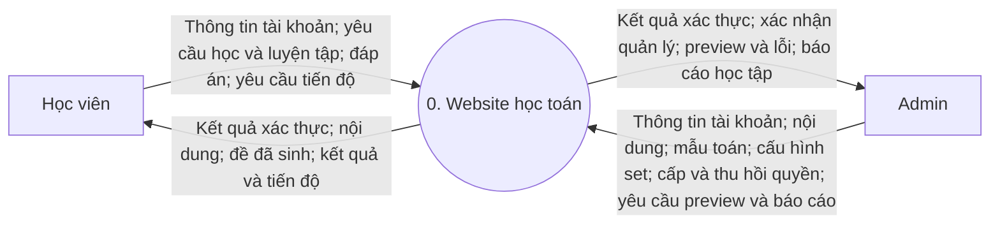
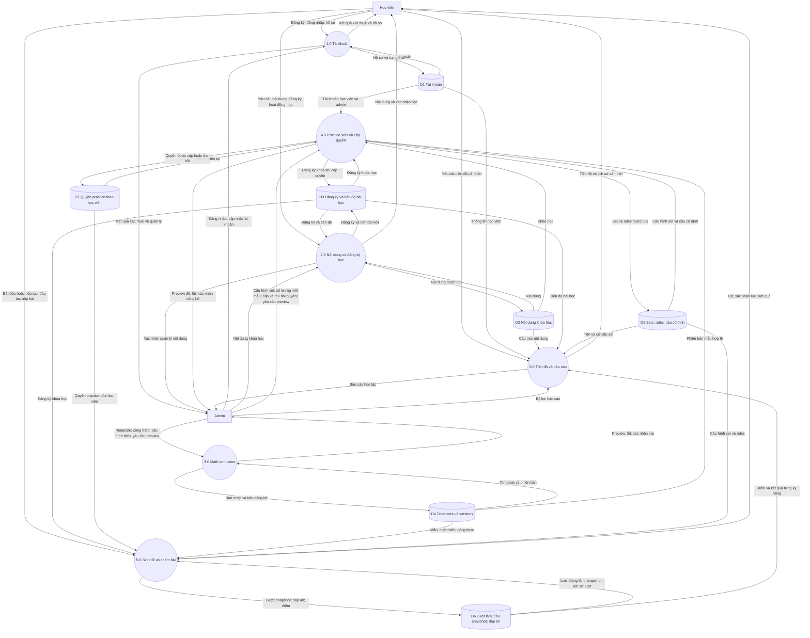
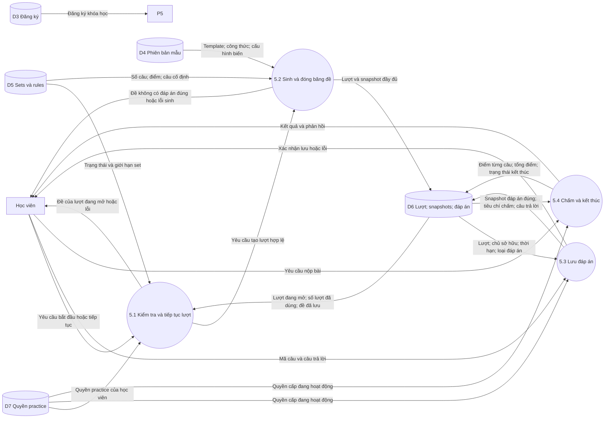
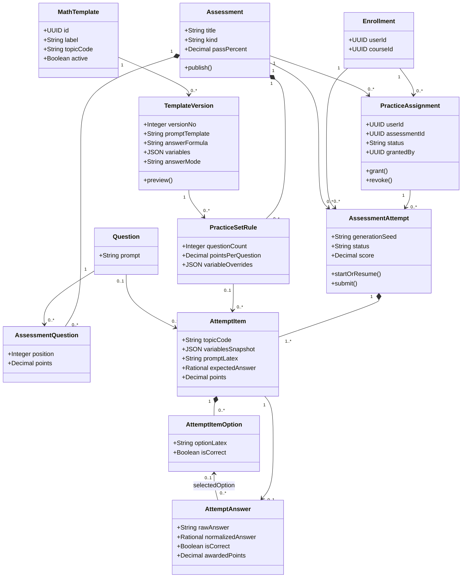
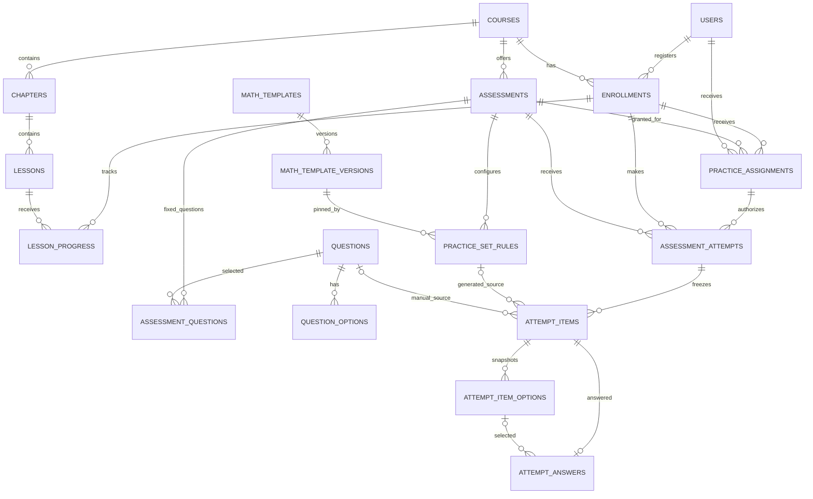

# Thiết kế website học toán — Math Templates và Practice Sets

## 1. Yêu cầu và mô hình chính

Thiết kế ban đầu có **học viên (USER)** và **admin (ADMIN)**; website hiện có thêm **TEACHER** (giáo viên), **SUPERVISOR** (giám sát) và **EDITOR** (biên tập viên) (mục 10.1). Nội dung gồm môn học → khóa học → chương → bài học, luyện tập và theo dõi quá trình học. Nhân viên tạo mẫu câu hỏi có LaTeX, biến ngẫu nhiên và công thức đáp án; sau đó kết hợp nhiều mẫu vào một practice set.

Hai ảnh tham chiếu được dùng làm gợi ý cho form và cú pháp. Mục 1–9 là thiết kế ban đầu và website đã triển khai theo đó (xem `README.md`). Mục 10 mô tả những gì được bổ sung sau.

**Ví dụ:** practice set **“LCM và nhân số thập phân”** có hai dòng cấu hình:

| Thứ tự | Math template | Phiên bản | Số câu | Điểm/câu |
|---|---|---|---:|---:|
| 1 | Least Common Multiple | v1 | 5 | 1 |
| 2 | Decimal Multiplication | v1 | 5 | 1 |
| **Tổng** | | | **10** | **10 điểm** |

Thiết kế mặc định hiểu “chọn 5 câu” là **chọn mẫu và yêu cầu sinh 5 câu khác nhau**. Admin cũng có thể chọn câu cố định từ ngân hàng câu hỏi; những câu này được lưu trong `assessment_questions`. Một set có thể kết hợp câu cố định và câu sinh từ mẫu.

Một template không phải một câu hỏi cố định. Template LCM với `{a}` và `{b}` có thể sinh “LCM của 12 và 18”, “LCM của 8 và 20”… Một practice set định nghĩa cơ cấu đề; một lượt làm chứa **10 câu cụ thể đã sinh và đóng băng**.

## 2. Chức năng và giao diện admin

### 2.1. Quản lý Math Templates

Form gồm các trường tương ứng ảnh tham chiếu:

| Trường | Ý nghĩa / quy tắc |
|---|---|
| Label | Tên mẫu, ví dụ Least Common Multiple |
| Topic | Mã kỹ năng: `lcm`, `decimal_multiplication`… |
| Vị trí (Place) | Một môn học, khóa học, chương hoặc bài học, chọn từ cây nội dung (mục 10.2) |
| Template | Nội dung có LaTeX và `{placeholder}` |
| Answer formula | Biểu thức dùng cùng tên biến; bắt buộc với câu được chấm |
| Answer mode | Numeric / Multiple choice / Display only |
| Min / Max | Miền mặc định cho biến nguyên |
| Variables | Miền riêng, kiểu integer/decimal và số chữ số thập phân |
| Constraints | Điều kiện sinh, ví dụ `a != b`, `b != 0` |
| Grading tolerance (%) | Sai số tương đối, mặc định 0 cho LCM và phép nhân chính xác |
| Absolute tolerance | Sai số tuyệt đối, mặc định 0 |
| Decimal places | Số chữ số khi hiển thị đáp án làm tròn |
| Accept rounded decimal | Cho phép đáp án đã làm tròn theo cấu hình |
| Đáp án sai | Chỉ cho trắc nghiệm: công thức cho các lựa chọn sai; thiếu thì hệ thống tự sinh |
| Hình vẽ (Figure) | Hình có nhãn, vẽ cho từng câu hỏi (mục 10.3) |
| Active / Lưu trữ | Có cho phép dùng mẫu để tạo lượt mới không; mẫu đã lưu trữ chỉ hiện ở tab Archive |

Luồng: **Tạo bản nháp → Preview một nhóm câu và đáp án → Kiểm tra → Publish version**. Sửa mẫu đã công bố tạo phiên bản mới; không ghi đè bản cũ. Preview cần hiển thị câu đã render, giá trị các biến, đáp án chính xác, đáp án làm tròn và cảnh báo lỗi.

`Display only` dùng cho ví dụ trong bài giảng, không được đưa vào practice set có tính điểm. MVP chấm kết quả số hoặc lựa chọn; chưa chấm biểu thức đại số tương đương.

### 2.2. Cú pháp và ví dụ

**LCM:**

```text
Label: Least Common Multiple
Topic: lcm
Template: Tìm bội chung nhỏ nhất của {a:2–20} và {b:2–20}.
Answer formula: lcm(a, b)
Answer mode: numeric
Constraints: a != b
Tolerance: 0
Accept rounded decimal: false
```

Nếu `a = 12`, `b = 18`: câu hỏi “Tìm bội chung nhỏ nhất của 12 và 18”, đáp án **36**. Hàm `lcm` chỉ nhận số nguyên dương trong mẫu này.

**Nhân số thập phân:**

```text
Label: Decimal Multiplication
Topic: decimal_multiplication
Template: Tính {a} \times {b}.
Answer formula: a * b
Answer mode: numeric
Variables:
  a: {type: decimal, min: 1.1, max: 9.9, scale: 1}
  b: {type: decimal, min: 1.1, max: 9.9, scale: 1}
Tolerance: 0
Decimal places: 2
Accept rounded decimal: false
```

Nếu `a = 2.4`, `b = 1.5`: hiển thị \(2.4 \times 1.5\), đáp án **3.6**. Sinh biến decimal bằng cách chọn số nguyên trong miền đã nhân với `10^scale`, rồi chia lại; dùng decimal/rational, không dùng floating-point nhị phân để chấm chính xác.

**Phân số, theo quy ước ảnh tham chiếu:**

```text
Template: \frac{{a}}{{b}} + \frac{{c}}{{d}}
Answer formula: a / b + c / d
Constraints: b != 0, d != 0
```

Parser phải tách token placeholder và dấu ngoặc LaTeX trước khi thay thế: `{{a}}` trở thành một nhóm LaTeX chứa giá trị `a`, còn `{a}` ở ngoài nhóm trở thành giá trị trực tiếp. Không dùng phép thay thế chuỗi đơn giản. Nên dành tên biến `p_a`, `p_b`… khi tên biến có thể trùng với nội dung LaTeX cố định.

Quy ước:

- Mỗi tên biến chỉ sinh một giá trị trong một câu; mọi lần xuất hiện dùng lại giá trị đó.
- `{a:min–max}` khai báo miền cho biến nguyên. Chấp nhận dấu `-` và `–` trong phần phân cách miền qua parser có grammar rõ ràng; hỗ trợ cận âm.
- Miền trong cấu hình Variables và miền inline phải khớp nếu cùng xuất hiện; mâu thuẫn là lỗi validation. Override tại dòng practice set có ưu tiên cao nhất và được lưu vào snapshot.
- `{+-}` sinh dấu `+` hoặc `−`, đồng thời cung cấp `s = 1` hoặc `s = -1` cho công thức; ví dụ `{a}x {+-} {b} = {c}`, đáp án `(c - s*b)/a`, với `a != 0`.
- Bản đầu hỗ trợ `+ - * /`, ngoặc, `gcd`, `lcm`, `abs`, `min`, `max`, `round`, `floor`, `ceil` và điều kiện đơn giản. Các hàm lượng giác/tổ hợp trong ảnh là khả năng mở rộng, không mặc định đã hỗ trợ.
- Công thức dùng tên biến trực tiếp như `a*b`; không phải chuỗi LaTeX.

Evaluator dùng parser và danh sách toán tử/hàm cho phép; không thực thi công thức bằng `eval`. Giới hạn độ dài biểu thức, độ sâu, miền biến, số lần thử sinh và kích thước kết quả. Render LaTeX với cấu hình không cho phép HTML hoặc lệnh tùy ý.

### 2.3. Tạo practice set

1. Nhập tên set, khóa học, ngưỡng đạt, thời gian và số lượt tối đa.
2. Thêm dòng LCM v1, số câu 5, điểm/câu 1.
3. Thêm dòng Decimal Multiplication v1, số câu 5, điểm/câu 1.
4. Tùy chỉnh miền biến cho mỗi dòng nếu cần.
5. Preview đề gồm 10 câu và đáp án; mặc định nhóm câu theo thứ tự dòng.
6. Publish set để học viên bắt đầu làm.

Có thể thay dòng, số lượng và cài đặt khi set còn nháp và cả sau khi công bố: học viên nhận thay đổi ở lượt làm sau, các lượt cũ giữ nguyên câu hỏi đã lưu. Dòng bị xóa mà lượt cũ còn tham chiếu được giữ lại với `removed_at`. Preview không phải lượt làm của học viên và không tính vào tiến độ.

Mỗi lượt sinh đề mới; reload/resume cùng lượt dùng lại đề đã lưu. Không yêu cầu hai học viên nhận cùng đề trong MVP.

### 2.4. Đăng nhập và cấp practice theo từng học viên

**Practice bắt buộc đăng nhập.** Mặc định học viên không có quyền với bất kỳ set nào; đăng ký khóa học, cùng trường hoặc email cùng domain không tự mở practice. Admin cấp từng set cho từng tài khoản cụ thể.

Ví dụ:

| Học viên | Practice 1 | Practice 2 | Practice 3 |
|---|---|---|---|
| `tmai@cccd.edu` | Được cấp | Được cấp | Không được cấp |

Admin tìm tài khoản theo email → xem hồ sơ → chọn các practice → lưu. Database lưu `user_id`, không dùng email làm khóa quan hệ; đổi email không làm mất quyền hay lịch sử. Domain `cccd.edu` chỉ là thông tin của email, không phải quy tắc cấp quyền.

- Dashboard học viên chỉ liệt kê set đã công bố, thuộc khóa đã đăng ký và có quyền `active`.
- Admin có thể cấp trước khi set công bố; học viên chỉ sử dụng được sau khi công bố.
- Khi cấp quyền, nếu học viên chưa đăng ký khóa chứa set, backend tạo đăng ký trong cùng transaction. Việc đăng ký đó không mở những practice khác của khóa.
- Khách chưa đăng nhập gọi API practice nhận `401`. Tài khoản đăng nhập nhưng không được cấp/đã bị thu hồi nhận `403`; không trả nội dung đề.
- Kiểm tra trên server ở mọi thao tác xem set, bắt đầu, tiếp tục, lưu đáp án và nộp bài. Đường dẫn trực tiếp không bỏ qua quyền.
- Chỉ admin, và giáo viên với học viên của mình (mục 10.1), được cấp/thu hồi; không cho học viên tự gọi endpoint cấp quyền.
- Thu hồi giữ nguyên bản ghi quyền và toàn bộ kết quả. Học viên không tiếp tục hoặc gửi đáp án/nộp qua API sau thu hồi; vẫn xem được kết quả các lượt đã kết thúc của chính mình. Admin vẫn xem mọi lịch sử.
- Lượt đang mở bị chặn sau thu hồi; tác vụ hết giờ vẫn chấm khi tới hạn. Lượt không có thời hạn giữ trạng thái đang làm và có thể tiếp tục nếu được cấp lại; không tự tính thành lượt đạt/chưa đạt.
- Cấp lại dùng cùng bản ghi quyền, cập nhật người/thời gian cấp và xóa trường thu hồi; số lượt đã làm không reset.

`practice_assignments` quản lý quyền hiện tại. Khóa ngoại từ lượt làm bảo đảm có bản ghi cấp quyền, còn việc quyền đang `active` do backend kiểm tra. Giới hạn lượt/thời gian vẫn lấy từ set trong MVP.

## 3. DFD

Sơ đồ dùng hình chữ nhật cho tác nhân, hình tròn cho tiến trình và hình trụ cho kho dữ liệu. Mũi tên mô tả dữ liệu, không phải thứ tự thao tác.

### 3.1. Sơ đồ ngữ cảnh



### 3.2. DFD mức 0



### 3.3. DFD mức 1 — tiến trình 5.0



## 4. UML

### 4.1. Use Case

Sơ đồ chuẩn PlantUML ở `use-cases.puml`.

**Admin:** quản lý tài khoản, nội dung; tạo/sửa mẫu; preview; công bố phiên bản; tạo set và chọn số câu từng mẫu; công bố set; cấp/thu hồi từng set cho học viên; xem báo cáo.

**Học viên:** đăng ký/đăng nhập; đăng ký khóa học; học bài; bắt đầu/tiếp tục set; lưu đáp án; nộp bài; xem tiến độ và kết quả theo kỹ năng.

**Giáo viên:** tạo học viên trong khóa/lớp của mình; tạo/sửa mẫu và set của mình; cấp/thu hồi set cho học viên của mình; xem kết quả và báo cáo của học viên mình. **Biên tập viên:** quản lý nội dung, mẫu, set và ngân hàng câu hỏi; không truy cập tài khoản hay dữ liệu học viên. **Giám sát:** xem mọi thứ, không thay đổi gì.

### 4.2. Class diagram



Đây là mô hình miền của phần luyện tập. Khi tạo lượt thành công phải có ít nhất một item; mỗi item lấy nguồn từ câu cố định **hoặc** một rule của template.

### 4.3. Sequence — bắt đầu set 5 LCM + 5 Decimal Multiplication

```mermaid
sequenceDiagram
    actor U as Học viên
    participant API as Practice API
    participant E as Template Engine
    participant DB as Database
    U->>API: Bắt đầu practice set
    API->>API: Xác thực và kiểm tra quyền
    API->>DB: BEGIN; khóa dòng đăng ký và quyền được cấp
    API->>DB: Kiểm tra quyền active cho học viên và set
    API->>DB: Đọc set; lượt hiện tại; số lượt đã dùng
    alt Có lượt đang mở
        API->>DB: Đọc snapshot; COMMIT
        API-->>U: Trả đề và đáp án đã nhập
    else Đủ điều kiện tạo lượt
        API->>DB: Đọc rules và phiên bản mẫu đã ghim
        DB-->>API: LCM v1 × 5; Decimal v1 × 5
        API->>E: Sinh 10 câu với seed và cấu hình
        E->>E: Kiểm tra miền, điều kiện, đáp án và trùng câu
        alt Sinh đủ 10 câu hợp lệ
            E-->>API: 10 snapshot và đáp án chính xác
            API->>DB: Lưu lượt, items, lựa chọn; COMMIT
            API-->>U: 10 câu và lựa chọn, không có đáp án đúng
        else Không sinh đủ trong giới hạn
            E-->>API: Lỗi cấu hình hoặc không đủ biến thể
            API->>DB: ROLLBACK
            API-->>U: Lỗi; không tiêu hao lượt
        end
    else Không đủ điều kiện
        API->>DB: ROLLBACK
        API-->>U: Lỗi truy cập hoặc hết lượt
    end
```

### 4.4. Sequence — nộp bài

```mermaid
sequenceDiagram
    actor U as Học viên
    participant API as Practice API
    participant G as Grading Service
    participant DB as Database
    U->>API: Nộp bài
    API->>API: Kiểm tra đăng nhập và quyền sở hữu
    API->>DB: BEGIN; khóa dòng quyền rồi dòng lượt làm
    API->>DB: Kiểm tra quyền active; thiếu quyền thì ROLLBACK và trả 403
    DB-->>API: Trạng thái và thời hạn
    alt Đã kết thúc
        API->>DB: COMMIT
        API-->>U: Kết quả đã lưu
    else Đang làm
        API->>DB: Đọc items, đáp án đúng snapshot và câu trả lời
        API->>G: Chấm theo snapshot và quy tắc từng câu
        G-->>API: Điểm từng câu; tổng điểm; đạt/chưa đạt
        API->>DB: Ghi kết quả; submitted hoặc expired; COMMIT
        API-->>U: Tổng điểm và kết quả từng kỹ năng
    end
```

## 5. Database

`schema.sql` là schema PostgreSQL hoàn chỉnh cho database mới, **không phải migration** cho bản cũ. Có 18 bảng; `assessments` giữ vai trò header cho practice set (`kind = 'practice'`) hoặc bài kiểm tra (`kind = 'test'`).

### 5.1. ERD quan hệ



### 5.2. Các bảng

| Bảng | Vai trò |
|---|---|
| `users` | Tài khoản, hash mật khẩu, vai trò (USER, TEACHER, SUPERVISOR, EDITOR, ADMIN), trạng thái, tag |
| `course_teachers`, `teacher_tags` | Khóa học và tag lớp của giáo viên, xác định học viên của họ |
| `subjects` | Cây môn học (nhiều cấp) phía trên khóa học, video và mẫu |
| `lesson_sections`, `lesson_section_templates` | Các phần của bài học (video, giải thích, ví dụ) và bài luyện kèm theo |
| `videos` | Bài học video trong thư viện, có thể gắn một mẫu luyện tập |
| `courses`, `chapters`, `lessons` | Khóa học, chương và nội dung bài học |
| `enrollments` | Một đăng ký mỗi học viên/khóa |
| `lesson_progress` | Trạng thái, phần trăm, thời gian học từng bài |
| `questions`, `question_options` | Ngân hàng câu trắc nghiệm cố định |
| `assessments` | Tên set, loại, ngưỡng đạt, giới hạn lượt/thời gian |
| `assessment_questions` | Câu cố định được admin chọn vào set |
| `math_templates` | Tên, topic, Active, người tạo và một vị trí: `subject_id`, `course_id`, `chapter_id` hoặc `lesson_id` |
| `math_template_versions` | LaTeX, công thức, biến, constraints, tiêu chí chấm, công thức đáp án sai và hình vẽ theo phiên bản |
| `practice_set_rules` | Phiên bản mẫu, số lượng câu, điểm/câu và override |
| `practice_assignments` | Quyền học viên với từng set, active/revoked, người và thời gian cấp/thu hồi |
| `assessment_attempts` | Lượt làm, seed, engine version, thời hạn và điểm |
| `attempt_items` | Câu cụ thể, biến, đáp án chính xác, tiêu chí chấm và hình vẽ (`figure_svg`) đã đóng băng |
| `attempt_item_options` | Các lựa chọn đã sinh hoặc sao chép cho từng item |
| `attempt_answers` | Câu trả lời học viên, giá trị chuẩn hóa và điểm từng item |

Ví dụ dữ liệu logic:

```text
assessments: SET-01, "LCM và nhân số thập phân", practice
practice_set_rules:
  RULE-01: SET-01, LCM-v1,                 question_count=5, points=1
  RULE-02: SET-01, DecimalMultiplication-v1, question_count=5, points=1
assessment_attempts:
  ATTEMPT-01: student-A, SET-01, max_score=10
attempt_items:
  positions 1–5:  source RULE-01, mỗi dòng có a,b và đáp án riêng
  positions 6–10: source RULE-02, mỗi dòng có a,b và đáp án riêng
```

Các mã ở ví dụ là nhãn minh họa; schema thực tế dùng UUID.

### 5.3. Ràng buộc và transaction

Database bảo đảm:

- Email duy nhất không phân biệt hoa thường; đăng ký không trùng.
- Bài và đề thuộc đúng khóa đã đăng ký qua khóa ngoại ghép.
- Mỗi rule có số lượng dương; một vị trí trong set chỉ có một rule.
- Tối đa một lượt đang mở mỗi học viên/set.
- Item lấy nguồn đúng set: từ câu cố định hoặc từ đúng rule/phiên bản.
- Đáp án trỏ đúng item trong lượt; lựa chọn trỏ đúng item.
- Rational lưu tử nguyên và mẫu nguyên dương; tổng điểm không âm và không vượt điểm tối đa.

Dịch vụ ứng dụng vẫn phải kiểm tra:

- Phân quyền; trạng thái tài khoản; quyền sở hữu lượt; trạng thái công bố; quyền `practice_assignments.status = active` trên mọi API sử dụng practice.
- Khi cấp quyền, khóa dòng đăng ký (tạo nếu chưa có) rồi upsert bản ghi quyền. Chỉ admin, và giáo viên với học viên của mình, được cấp, và chỉ cho tài khoản USER; cấp quyền không reset lịch sử hay giới hạn lượt.
- Thu hồi, bắt đầu, lưu và nộp đều khóa dòng quyền trước dòng lượt; nếu cần khóa đăng ký thì khóa đăng ký trước quyền. Nhờ cùng thứ tự khóa, việc thu hồi không bị yêu cầu đã kiểm tra quyền nhưng chưa ghi dữ liệu vượt qua.
- Schema JSON của biến, tên biến, AST công thức, miền nguyên/thập phân và constraints.
- Phiên bản công bố không thay đổi; nội dung template được dùng trong đề cũ không bị ghi đè. Set công bố khóa cả rules, câu cố định, điểm, ngưỡng đạt và giới hạn lượt/thời gian; được phép chuyển sang archived để chặn lượt mới.
- Không dùng mẫu `display_only` trong set chấm điểm.
- Tạo đủ số item theo từng rule; tổng điểm tối đa bằng tổng điểm item. Nếu có câu cố định, đặt các câu này sau các nhóm template, theo `assessment_questions.position`.
- Câu trắc nghiệm có đúng 4 lựa chọn khác nhau khi sinh tự động, đúng một lựa chọn đúng; câu cố định có ít nhất 2 lựa chọn và đúng một lựa chọn đúng. Không tạo được distractor hợp lệ thì báo lỗi, không lặng lẽ đổi loại câu.
- `answer_mode` khớp loại đáp án; numeric được parse sang rational; điểm từng câu không vượt `points`.
- Sinh đề và lưu cả lượt/items/options trong một transaction. Thất bại rollback, không tiêu hao lượt.
- Khóa dòng đăng ký khi cấp lượt để tránh vượt giới hạn; khóa dòng lượt khi lưu/nộp để tránh sửa đáp án sau chấm.
- Tác vụ nền kết thúc lượt hết giờ và chấm những đáp án đã lưu.

Schema chưa có trigger thực hiện các quy tắc ứng dụng này. Các bảng chứa đáp án đúng chỉ được backend truy cập; DTO gửi client phải loại bỏ đáp án, công thức và cờ `is_correct` trong khi làm bài.

## 6. Sinh câu và chấm điểm

### 6.1. Sinh câu

1. Nạp phiên bản được ghim ở rule; kiểm tra mẫu Active và phiên bản được công bố khi tạo lượt mới.
2. Áp dụng override, sinh mỗi biến một lần, kiểm tra constraints.
3. Tính đáp án qua evaluator, kiểm tra lỗi chia 0 và giới hạn kết quả.
4. Render LaTeX; tạo lựa chọn nếu cần.
5. Tạo fingerprint từ version, biến và nội dung chuẩn hóa; loại câu trùng trong cùng nhóm.
6. Lặp đến đủ số lượng; giới hạn đề xuất 100 lần thử cho mỗi câu. Không đủ thì báo lỗi rõ ràng để admin tăng miền hoặc giảm số câu.
7. Lưu snapshot, seed và engine version. Snapshot là nguồn chính khi resume/chấm; seed phục vụ tái hiện và kiểm tra, không thay thế snapshot.

Với phép nhân và LCM, cặp `(a,b)` và `(b,a)` được chuẩn hóa về cùng fingerprint để tránh câu giống nhau chỉ đổi thứ tự. Đặt `active=false` chặn lượt mới dùng mẫu; lượt cũ tiếp tục bằng snapshot.

### 6.2. Chấm câu numeric

Chấp nhận số nguyên, số thập phân và phân số như `3.6`, `3.60`, `18/5`. UI có thể chuẩn hóa dấu phẩy thập phân `3,6` thành `3.6`; không hỗ trợ dấu phân cách hàng nghìn trong MVP. Input sai cú pháp được báo lỗi khi lưu, không biến thành số 0.

Lưu số chính xác dưới dạng rational `numerator/denominator`. Với giá trị chính xác `y` và đáp án chuẩn hóa `x`:

```text
limit = max(absolute_tolerance, abs(y) * relative_tolerance_percent / 100)
correct_exact_or_tolerant = abs(x - y) <= limit
correct_rounded = accept_rounded_decimal AND x == round_half_up(y, decimal_places)
correct = correct_exact_or_tolerant OR correct_rounded
```

Khi đáp án bằng 0, sai số tương đối bằng 0; muốn nhận sai số gần 0 phải cấu hình sai số tuyệt đối. Không làm tròn đáp án đúng trước khi kiểm tra sai số. Chấp nhận đáp án làm tròn là một nhánh riêng; nếu bật, câu hỏi phải nói rõ số chữ số cần làm tròn.

MVP dùng **ROUND_HALF_UP**, với điểm giữa âm làm tròn ra xa 0. Câu bỏ trống được 0 điểm. Các bài LCM và nhân decimal chính xác dùng cả hai tolerance bằng 0, không bật nhận đáp án làm tròn.

### 6.3. Chấm câu multiple choice

Chấm lựa chọn theo `attempt_item_options.is_correct` đã snapshot. Lựa chọn sai/không chọn được 0; đúng được toàn bộ điểm câu. Distractor numeric phải khác nhau sau render và không tương đương đáp án đúng theo tiêu chí chấm; công thức đáp án luôn được tính trên server.

## 7. Theo dõi quá trình học

Dashboard học viên hiển thị hai nhóm chỉ số:

- **Học bài:** bài hoàn thành / bài đã công bố × 100; thời gian hoạt động và bài gần nhất.
- **Luyện tập:** số set đã làm, lượt đã kết thúc, điểm gần nhất/cao nhất, lịch sử và độ chính xác theo topic.

Ví dụ sau một lượt 10 câu:

| Kỹ năng | Câu đúng | Tổng câu | Tỷ lệ đúng |
|---|---:|---:|---:|
| LCM | 4 | 5 | 80% |
| Nhân số thập phân | 3 | 5 | 60% |
| Tổng | 7 | 10 | 70% |

Nhờ `attempt_items.topic_code`, báo cáo có thể gợi ý học viên luyện thêm nhân số thập phân. Đây là kết quả quan sát được, chưa phải thước đo đầy đủ về mức độ thành thạo.

Chỉ đưa lượt `submitted` và `expired` vào thống kê điểm. Phân biệt **tỷ lệ câu đúng** với **tỷ lệ điểm đạt được** khi các câu có trọng số khác nhau. Thống kê nhiều lượt phải ghi rõ đang dùng mọi lượt, lượt gần nhất hay lượt cao nhất.

Thời gian học dùng heartbeat được server kiểm tra và chống cộng lặp. View `course_learning_summary` chỉ tổng hợp bài đang công bố; thêm bài mới có thể làm tỷ lệ hoàn thành giảm. Hoàn thành nội dung không đồng nghĩa đạt kiểm tra.

Truy vấn kết quả từng kỹ năng của một lượt, với `$1` là UUID lượt sau khi kiểm tra quyền sở hữu:

```sql
SELECT i.topic_code,
       COUNT(*) AS total_questions,
       COUNT(*) FILTER (WHERE a.is_correct IS TRUE) AS correct_questions,
       ROUND(100.0 * COUNT(*) FILTER (WHERE a.is_correct IS TRUE)
             / COUNT(*), 2) AS accuracy_percent,
       SUM(COALESCE(a.awarded_points, 0)) AS score,
       SUM(i.points) AS max_score
FROM attempt_items i
JOIN assessment_attempts t ON t.id = i.attempt_id
LEFT JOIN attempt_answers a ON a.attempt_id = i.attempt_id AND a.item_id = i.id
WHERE i.attempt_id = $1 AND t.status IN ('submitted', 'expired')
GROUP BY i.topic_code;
```

## 8. API gợi ý

| API | Chức năng |
|---|---|
| `POST /admin/math-templates` | Tạo mẫu và bản nháp đầu tiên |
| `POST /admin/math-templates/{id}/versions` | Tạo phiên bản mới |
| `PATCH /admin/template-versions/{id}` | Sửa bản nháp |
| `POST /admin/template-versions/{id}/preview` | Sinh nhóm câu mẫu và đáp án cho admin |
| `POST /admin/template-versions/{id}/publish` | Kiểm tra và công bố phiên bản |
| `POST /admin/practice-sets` | Tạo assessment loại practice |
| `PUT /admin/practice-sets/{id}/rules` | Cấu hình các dòng template và số câu |
| `POST /admin/practice-sets/{id}/preview` | Preview đúng cơ cấu set |
| `POST /admin/practice-sets/{id}/publish` | Công bố set |
| `PUT /admin/users/{userId}/practice-assignments/{setId}` | Cấp hoặc cấp lại quyền cho tài khoản |
| `DELETE /admin/users/{userId}/practice-assignments/{setId}` | Thu hồi logic, không xóa quyền/kết quả |
| `GET /admin/users/{userId}/practice-assignments` | Xem các set được cấp và trạng thái |
| `GET /me/practice-sets` | Chỉ liệt kê set đã công bố và được cấp active |
| `GET /admin/users/{userId}/practice-results` | Xem số lượt và điểm từng lượt theo set |
| `POST /practice-sets/{id}/attempts` | Bắt đầu hoặc tiếp tục lượt đang mở |
| `PUT /attempts/{id}/answers/{itemId}` | Lưu đáp án numeric hoặc lựa chọn |
| `POST /attempts/{id}/submit` | Nộp và chấm theo snapshot |
| `GET /me/progress`, `GET /me/attempts` | Tiến độ và lịch sử cá nhân |
| `GET /admin/reports/learning` | Báo cáo theo khóa, học viên và topic |
| `POST /admin/math-templates/import` | Nhập file ngân hàng mẫu (mục 10.4) |
| `POST /admin/math-templates/move`, `/archive`, `/delete` | Đổi vị trí, lưu trữ/khôi phục hoặc xóa nhiều mẫu |
| `PATCH /admin/users/{id}` | Đổi tên, vai trò, trạng thái, tag hoặc mật khẩu (admin) |
| `GET/PUT /admin/users/{id}/teaching` | Khóa học và tag lớp của giáo viên |

Admin có thể xem đáp án trong preview; học viên không nhận các trường đáp án đúng khi đang làm bài. Mọi endpoint dùng `user_id` từ phiên xác thực, không tin ID học viên do client tự gửi.

## 9. Kiểm tra cần có khi triển khai

- Khách chưa đăng nhập bị chặn; tài khoản chỉ được cấp Practice 1/2 không thể xem/làm Practice 3 qua URL hoặc API.
- Cấp trùng không tạo thêm bản ghi; thu hồi không xóa điểm; đổi email không mất quyền; cấp lại không reset số lượt.
- Thu hồi đồng thời với lưu/nộp tuân theo thứ tự transaction; yêu cầu đến sau thu hồi bị chặn.
- Tự đăng ký khóa học hoặc cùng domain email không tự nhận quyền practice.
- Set 5 LCM + 5 Decimal sinh đúng 10 câu; tổng điểm 10; không trùng câu do đổi thứ tự toán hạng.
- Cùng placeholder xuất hiện nhiều lần giữ cùng giá trị; LaTeX phân số không bị thay sai ngoặc.
- Miền decimal có bước đúng; `2.4 * 1.5` chấm `3.6`, `3.60`, `18/5` như nhau.
- Biên tolerance, đáp án 0, số âm và quy tắc ROUND_HALF_UP.
- Miền quá nhỏ, chia 0, công thức sai, thiếu biến, công thức quá lớn và distractor trùng phải bị từ chối.
- Reload giữ đề; preview không tiêu hao lượt; thất bại sinh rollback; tạo lượt đồng thời không vượt giới hạn.
- Đổi phiên bản template không sửa lịch sử; ngừng Active không làm mất lượt đang mở.
- Nộp lặp, hết giờ, lưu đồng thời với nộp và truy cập lượt của người khác.

`schema.sql` là DDL của thiết kế ban đầu. Lược đồ đang dùng được tạo bởi các migration Flyway trong `backend/src/main/resources/db/migration` (V1–V16), chạy mỗi lần khởi động và đã kiểm thử trên PostgreSQL 17.

## 10. Bổ sung sau thiết kế ban đầu

### 10.1. Vai trò

| | ADMIN | EDITOR | TEACHER | SUPERVISOR |
|---|---|---|---|---|
| Tài khoản: tạo, đổi vai trò, đặt lại mật khẩu | ✅ | — | tạo học viên trong khóa/lớp của mình | xem |
| Cây nội dung, bài học, môn học, video | ✅ | ✅ | xem | xem |
| Mẫu, practice set, ngân hàng câu hỏi: tạo | ✅ | ✅ | ✅ | — |
| … sửa, công bố, lưu trữ, đổi vị trí, xóa | tất cả | tất cả | chỉ của mình | — |
| Kết quả, lượt làm, báo cáo của học viên | tất cả | — | học viên của mình | tất cả |
| Cấp / thu hồi set | ✅ | — | học viên của mình | — |

Học viên của giáo viên là những người đang đăng ký (active) một khóa học có trong `course_teachers` của giáo viên đó, cộng với những người có tag trùng một tag trong `teacher_tags` của giáo viên. Tự đăng ký luôn tạo USER. Không ai tự đổi vai trò của mình. Xóa khóa học còn lịch sử của học viên đã rời khóa chỉ admin được làm. Backend kiểm tra mọi quy tắc (`CurrentUser`: `requireStaff`, `requireAuthor`, `requireContent`, `requirePeople`, `requireOwner`, `requireStudentVisible`); giao diện chỉ ẩn những gì vai trò không dùng được.

### 10.2. Vị trí của mẫu

Mỗi mẫu nằm ở một vị trí: môn học, khóa học, chương hoặc bài học (tối đa một trong bốn cột được đặt). Chương, khóa học và môn học phía trên một bài học được suy ra khi đọc, nên chuyển bài học hoặc đổi môn của khóa học sẽ mang các mẫu theo. Xóa bài học chuyển mẫu lên chương, xóa chương chuyển lên khóa học, xóa khóa học chuyển lên môn học. Trang mẫu, trình sửa mẫu, chọn dòng cho practice set và trình sửa video dùng chung một cây: môn học › khóa học › chương › bài học. Khi chọn dòng cho practice set, cây bắt đầu ở môn học của khóa (hoặc chính khóa học).

### 10.3. Hình vẽ và nhiều câu hỏi trong một mẫu

- **Hình vẽ:** `{"shape": "rectangle", "labels": {"width": "{l} cm"}, "size": {"width": "l", "height": "w"}}`. Math-service vẽ SVG với giá trị của từng câu (hình chữ nhật, hình vuông, tam giác, tam giác vuông, hình tròn, hình thang, elip); backend lưu hình cùng item của lượt làm, frontend hiển thị qua `` (không chạy được script).
- **Text choice:** biến `{"type": "text_choice", "options": [...]}` mở rộng một mẫu thành nhiều biến thể (mỗi lựa chọn có văn bản riêng và có thể có biến, biến dẫn xuất, constraints, công thức đáp án và hình vẽ riêng); mỗi câu sinh ra chọn ngẫu nhiên một biến thể. Với `"answer_formula": "q.answer_formula"` hệ thống dùng công thức của lựa chọn được chọn.

### 10.4. Nhập mẫu

`POST /admin/math-templates/import` đặt mẫu vào `subject_path` của file hoặc của từng mẫu (ví dụ `Math-Template/Basic-Math/Area-and-Perimeter`, tự tạo thư mục còn thiếu); nếu không có thì đặt dưới môn gốc, mỗi `category` một môn con. Mẫu nhập vào thuộc về người nhập.
